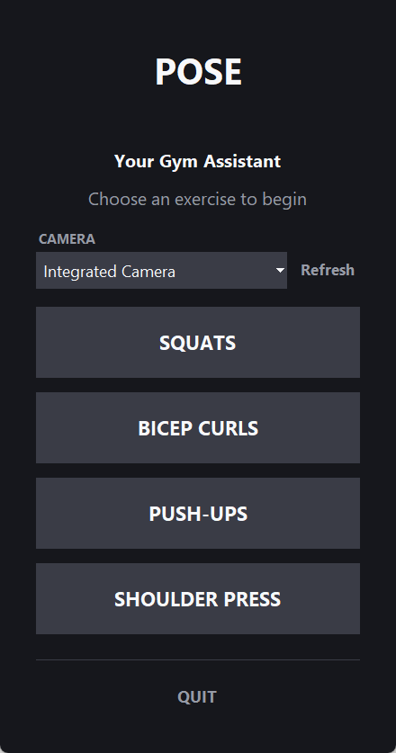
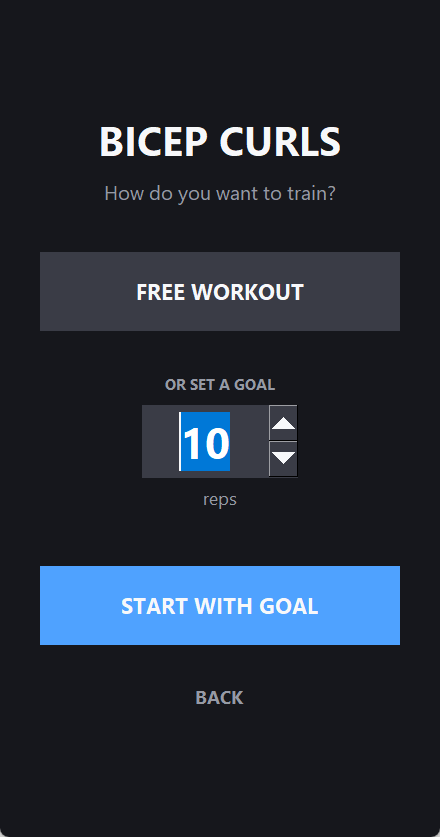
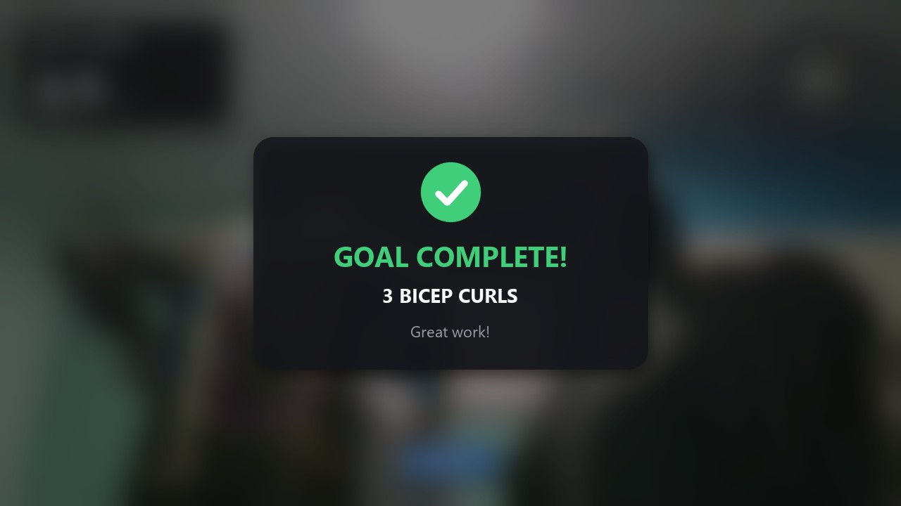
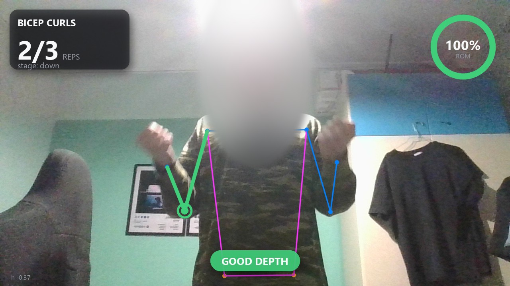

<h1 align="center">POSE</h1>

<p align="center">
  Real-time workout rep counter and form feedback using webcam pose estimation.
</p>

## Overview

POSE turns a webcam into a rep counter. A YOLO11 pose model locates 17 body keypoints in every frame, the angle of the joint that defines the exercise is computed from them, and a small state machine counts a repetition each time that angle completes a down-and-up cycle. The on-screen overlay reports the rep count, range of motion and depth feedback in real time.

Supported exercises: squats, bicep curls, push-ups and shoulder presses. Sessions can be free-form or run against a rep goal.

## Features

- **Rep counting** driven by joint angles, with a moving-average filter to suppress keypoint jitter.
- **Goal mode.** Set a target of 1 to 999 reps. The counter shows progress as `n/goal`, and reaching the goal ends the session with a blurred completion screen.
- **Depth feedback** (`GOOD DEPTH` / `GO DEEPER`) and a range-of-motion indicator.
- **Rep validation for shoulder press.** A repetition only counts if the wrist returns near shoulder height and reaches full overhead lockout.
- **Single-subject tracking.** Only the person most likely to be exercising is drawn and measured, so posters, printed clothing and bystanders are ignored.
- **Camera selection by device name**, for setups with more than one webcam.
- **Camera lifecycle control.** The camera is opened when a session starts and released when it ends, regardless of how it ends.

## Interface

<p align="center">
  
  &nbsp;&nbsp;&nbsp;
  
</p>
<p align="center">
  <sub>Left: camera and exercise selection. Right: free workout or rep goal.</sub>
</p>

<p align="center">
  
</p>
<p align="center">
  <sub>Completion screen, shown for a few seconds when the rep goal is reached.</sub>
</p>

<p align="center">
  
</p>

## Installation

**Steps**

```bash
git clone https://github.com/JasonMar1/POSE.git
cd POSE

python -m venv .venv
.venv\Scripts\activate
pip install -r requirements.txt
```

On Windows, pip installs a CPU-only build of PyTorch by default. To use an NVIDIA GPU, install the CUDA build of PyTorch first (see [pytorch.org](https://pytorch.org/get-started/locally/) for the command matching your CUDA version), then run `pip install -r requirements.txt`.

The model weights (`yolo11n-pose.pt`, about 6 MB) are downloaded automatically on first launch.

## Usage

```bash
python gui.py
```

1. Select a camera from the dropdown. Use **Refresh** after connecting a new device.
2. Select an exercise.
3. Choose **Free workout**, or enter a rep target and choose **Start with goal**.
4. Perform the exercise. Press `q` or close the window to end the session early.
5. When the session ends you return to the home screen, which shows the result of the last session.

## How It Works

1. **Pose estimation.** YOLO11n-pose returns 17 keypoints for each person in the frame.
2. **Subject selection.** Each detection is scored as *person confidence × confidence of the joints the current exercise uses*. The highest score is kept and all other detections are discarded before drawing.
3. **Joint angle.** The exercise defines three joints; the angle at the middle one is computed with `atan2`. The side of the body with the higher keypoint confidence is used, keypoints below 0.5 confidence are ignored, and the result is averaged over the last 5 frames.
4. **Repetition counting.** Dropping below the exercise's *down* threshold enters the down phase. Rising above its *up* threshold afterwards completes one repetition.
5. **Shoulder press validation.** Elbow angle alone cannot distinguish a full press from a partial one, so the wrist height above the shoulder is also measured, in shoulder widths. At the bottom it must be below 0.2, and at lockout above 0.9 (Hardcoded values by me).

| Exercise | Angle measured at | Down below | Up above | Good depth below |
|---|---|---|---|---|
| Squat | Knee | 100° | 160° | 90° |
| Bicep curl | Elbow | 90° | 140° | 60° |
| Push-up | Elbow | 90° | 160° | 80° |
| Shoulder press | Elbow | 80° | 130° | 60° |

## Project Structure

```
POSE/
├── gui.py                Tkinter launcher: camera picker, exercise selection, goal screen
├── rep_counter.py        Engine: exercise definitions, angle math, session loop
├── overlay.py            Video overlay rendering and the shared colour theme
├── requirements.txt
└── docs/screenshots     Images used in this README
```

`gui.py` interacts with the engine only through `load_model()`, `list_cameras()`, `open_capture()` and `run_session()`. The engine has no dependency on the interface, so it can be driven from another front end or from a script.

## Configuration

| Setting | Location | Default |
|---|---|---|
| Capture resolution and frame rate | `_start()` in `gui.py` | 1280×720 at 30 fps |
| Model weights | `load_model()` in `rep_counter.py` | `yolo11n-pose.pt` |
| Angle smoothing window | `smooth` argument of `run_session()` | 5 frames |
| Keypoint confidence threshold | `CONF_THRESH` in `rep_counter.py` | 0.5 |
| Exercise thresholds | `EXERCISES` in `rep_counter.py` | see table above |

## Adding an Exercise

Add an entry to `EXERCISES` in `rep_counter.py`:

```python
"lunge": {
    "left":  ("l_hip", "l_knee", "l_ankle"),
    "right": ("r_hip", "r_knee", "r_ankle"),
    "down_thresh": 100,   # angle below this: down phase
    "up_thresh": 160,     # angle above this after a down phase: one repetition
    "good_depth": 90,     # angle below this: GOOD DEPTH feedback
    "label": "LUNGES",
},
```

The three joints define the angle, which is measured at the middle one. The home screen builds its buttons from this dictionary, so no interface changes are needed.

## Troubleshooting

| Symptom | Cause and fix |
|---|---|
| Nothing is counted | One of the three joints is below the confidence threshold. Keep the relevant joints in frame and improve lighting. |
| Squat depth is misjudged | Stand side-on so the working leg faces the camera. |
| Shoulder press counts incorrectly | Face the camera squarely. When turned sideways the shoulders overlap and the wrist-height measurement becomes unreliable. |
| Camera takes a very long time to open | Media Foundation hardware transforms can delay startup by close to a minute on some webcams. `rep_counter.py` disables them before importing OpenCV. Do not remove that line. |

## Built With

- [Ultralytics YOLO11](https://docs.ultralytics.com/) for pose estimation
- [OpenCV](https://opencv.org/) for camera capture and rendering
- [Tkinter](https://docs.python.org/3/library/tkinter.html) for the launcher
- [Pillow](https://python-pillow.org/) for overlay text rendering
- [pygrabber](https://github.com/bunkahle/pygrabber) for camera enumeration

